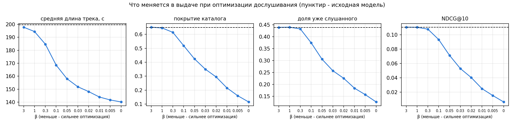
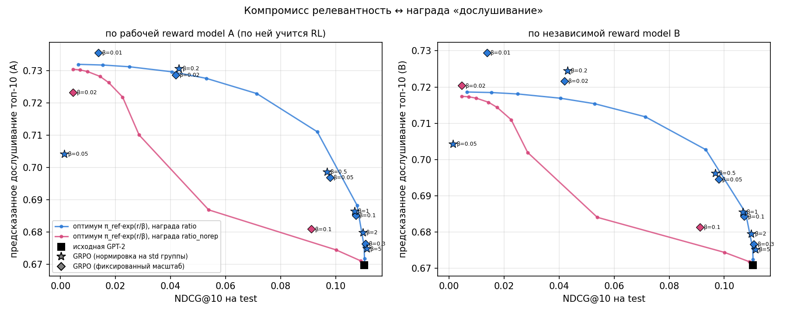
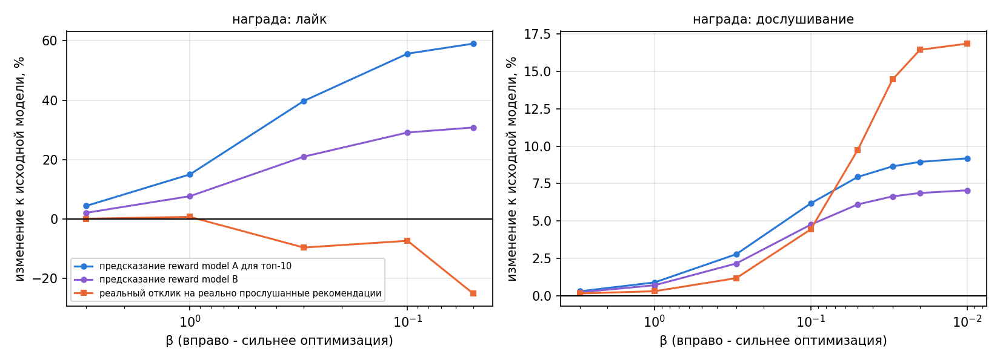

# Подробный отчёт

Краткая версия с итогами лежит в [README](README.md). Здесь собраны детали: протокол, качество
reward models, все RL-прогоны, разбор поведения, генерация на несколько шагов и долгосрочные цели.
Если не сказано иное, все цифры посчитаны на test (последние 7 дней).

**Содержание**
* [Данные и протокол](#данные-и-протокол) * [Базовая модель](#базовая-модель) * [Reward model](#reward-model) * [RL-дообучение](#rl-дообучение)
* Результаты: [поведение](#поведение-модели-после-rl) * [релевантность](#релевантность-и-разнообразие) * [компромисс](#компромисс-между-релевантностью-и-наградой) * [реальный отклик](#реальный-отклик-против-оценки-reward-model) * [разные награды](#разные-функции-награды) * [несколько шагов](#генерация-на-несколько-шагов) * [долгосрочные цели](#долгосрочные-цели)
* [Ограничения и что дальше](#ограничения-и-что-дальше) * [Структура кода](#структура-кода)

## Данные и протокол

[Yambda-50M](https://huggingface.co/datasets/yandex/yambda) от Яндекс Музыки содержит 46,5 млн
прослушиваний 9 238 пользователей за 300 дней. У каждого прослушивания есть доля дослушивания
(`played_ratio_pct`), длина трека и флаг `is_organic`, который говорит, нашёл ли пользователь трек
сам или его включила рекомендательная система. Лайки лежат отдельными событиями.

Разбиение по времени такое: train - всё до последних 14 дней, valid - следующие 7 дней, test -
последние 7. Все модели (GPT-2, reward models, RL) учатся только на train, а решения я принимал по
valid.

Словарь состоит из 50 тыс. самых популярных в train треков, на них приходится 80 % прослушиваний.
Остальные треки сливаются в один токен "вне словаря".

Точки оценки выбраны так: у каждого пользователя, активного в test, берётся до 3 случайных
прослушиваний. Модель видит 200 предыдущих прослушиваний и угадывает трек. Всего получается 23 597
точек от 8 024 пользователей. У 27 % точек правильного трека нет в словаре. Такие точки считаются
промахом, поэтому метрики занижены.

Для музыки повторы нормальны: у 26 % точек правильный трек уже встречался в последних 200
прослушиваниях. Поэтому повторы в рекомендациях я не запрещал, а измерял. Доверительные интервалы
везде считаются парным бутстрапом по пользователям.

## Базовая модель

GPT-2 из `transformers`: 4 слоя, размерность 256, 4 головы, контекст 200, 16 млн параметров. Модель
учится предсказывать следующий трек, лосс - кросс-энтропия по всему словарю из 50 тыс. треков.
Логиты считаются кусками и пересчитываются на обратном проходе, иначе обучение не помещается в 2 ГБ
видеопамяти. 8 эпох занимают около двух часов на RTX 4060.

| модель | NDCG@10 | Recall@10 | доля уже слушанного в топ-10 | покрытие каталога |
|---|---|---|---|---|
| популярное в train | 0.005 | 0.009 | 0.11 | 0.02 % |
| самое частое в истории пользователя | 0.053 | 0.098 | 0.99 | 67 % |
| **GPT-2** | **0.110** | **0.156** | 0.44 | 65 % |

## Reward model

Reward model - это каузальный трансформер по истории, где каждое событие состоит из трека и того,
насколько его дослушали. Для трека-кандидата модель предсказывает три отклика: долю дослушивания,
лайк в течение часа и продолжение сессии. Продолжение сессии означает, что следующее прослушивание
началось не позже чем через 30 минут. Это самый простой сигнал удержания, который есть в данных.
Кандидат описывается эмбеддингом, длиной трека и флагом `is_organic`. Рекомендации RL-политики
оцениваются с `is_organic = 0`, то есть ровно в ситуации "трек включила рекомендательная система".

Моделей две, у них разная архитектура и разный сид. По модели A учится RL, модель B служит
независимым судьёй.

Оценка сделана на 200 тыс. случайных прослушиваний из test:

| | дослушивание: MAE | дослушивание: AUC >= 90 % | лайк: AUC | продолжение: AUC |
|---|---|---|---|---|
| среднее | 0.410 | 0.500 | 0.500 | 0.500 |
| среднее по треку | 0.398 | 0.593 | 0.574 | 0.521 |
| среднее по пользователю | 0.333 | 0.751 | **0.783** | **0.625** |
| пользователь + трек | 0.326 | 0.753 | 0.777 | 0.619 |
| **reward model A** | **0.233** | **0.881** | 0.770 | 0.609 |
| reward model B | 0.229 | 0.883 | 0.773 | 0.613 |

Для RL эта таблица не главная. RL выбирает трек для фиксированного пользователя, поэтому важно, как
модель ранжирует треки внутри одного пользователя (`src/rm_report.py`):

| AUC внутри пользователя | дослушивание | лайк | продолжение сессии |
|---|---|---|---|
| reward model A | **0.743** | 0.689 | 0.556 |
| эвристика по треку | 0.548 | 0.533 | 0.511 |

Дослушивание модель различает хорошо. Лайк тоже различает, но этот сигнал в основном описывает
пользователя, а не трек. Продолжение сессии почти не отличается от монетки, и RL по такой награде
будет оптимизировать шум. Есть и ещё одна проблема: на реальных прослушиваниях A и B почти
совпадают, корреляция внутри пользователя 0.98. Как независимый судья B слабее, чем хотелось бы.
Проверка, которая от reward models не зависит совсем, описана в разделе про
[реальные отклики](#реальный-отклик-против-оценки-reward-model).

## RL-дообучение

Для истории пользователя политика сэмплирует G = 16 треков, и reward model A оценивает каждый.
Преимущество считается как `(r - среднее по группе) / std по группе`, градиент берётся как в
REINFORCE. Для одного шага без критика это и есть GRPO. Штраф `β * KL(π || π_ref)` к исходной модели
считается точно, по всему словарю: действие - один трек, и распределение известно целиком. Обучение
идёт 1 500 шагов по 64 истории с lr 3e-5, один прогон занимает около 15 минут.

Что я перебирал:

* силу штрафа β, от 0.05 до 5;
* нормировку преимущества: стандартную (на std группы) и фиксированную (на std наград первого
  батча, как в Dr. GRPO);
* функцию награды: дослушивание, ожидаемое время прослушивания (дослушивание x длина), лайк,
  дослушивание + лайк, продолжение сессии, дослушивание со штрафом за уже слушанное, среднее A и B;
* горизонт: один трек или последовательность из 5 треков с суммой наград.

## Результаты

### Поведение модели после RL

| β (нормировка на std группы) | NDCG@10 | Δ NDCG, 95% CI | дослушивание A / B | длина трека, с | уже слушанное | покрытие | топ-100 треков в выдаче |
|---|---|---|---|---|---|---|---|
| исходная | 0.110 | - | 0.670 / 0.671 | 200 | 0.44 | 65 % | 11 % |
| 5 | 0.111 | **+0.001 [+0.000, +0.002]** | 0.675 / 0.675 | 192 | 0.43 | 62 % | 12 % |
| 2 | 0.110 | -0.001 [-0.001, +0.000] | 0.680 / 0.680 | 185 | 0.43 | 60 % | 14 % |
| 1 | 0.107 | -0.004 [-0.005, -0.002] | 0.687 / 0.686 | 175 | 0.42 | 55 % | 20 % |
| 0.5 | 0.097 | -0.014 [-0.015, -0.012] | 0.699 / 0.696 | 159 | 0.37 | 43 % | 35 % |
| 0.2 | 0.043 | -0.067 [-0.070, -0.064] | 0.731 / 0.725 | 134 | 0.17 | 16 % | 82 % |
| 0.05 | 0.001 | -0.109 [-0.113, -0.105] | 0.704 / 0.704 | 133 | 0.03 | 0.4 % | 100 % |

Награда растёт, но недалеко: с 0.670 примерно до 0.73, даже если полностью пожертвовать
релевантностью. Модель получает её тремя способами.

Первый - короткие треки. Средняя длина рекомендаций падает с 200 до 134 секунд, потому что короткий
трек проще дослушать. Это тот самый хак, о котором предупреждает задание.

Второй способ я не ожидал: модель реже советует уже знакомое. Доля уже слушанного в выдаче падает
с 0.44 до 0.17. Скорее всего, дело в том, что набор коротких треков с высокой предсказанной наградой
у всех пользователей одинаковый, и он вытесняет персональные повторы.

Третий - сужение каталога. При β = 0.2 82 % выдачи занимают одни и те же 100 треков, при β = 0.05
почти вся выдача. Модель находит небольшой набор треков, которые reward model высоко оценивает для
всех, и перестаёт персонализировать.



### Релевантность и разнообразие

При β >= 2 релевантность сохраняется: NDCG@10 не отличается от исходного, а при β = 5 даже значимо
чуть выше, хотя предсказанное дослушивание выросло примерно на 1 %. При β = 1 NDCG теряет 3 %, при
β = 0.5 уже 12 %, ниже начинается обвал. Рекомендует ли модель всем одно и то же, видно по столбцам
"покрытие" и "топ-100 треков в выдаче". Разнообразие начинает портиться примерно при тех же β, что
и NDCG.

### Компромисс между релевантностью и наградой



Линии на графике - аналитический оптимум. Для одного шага задача
`max E_π[r] - β * KL(π || π_ref)` решается в закрытом виде: `π*(a) ~ π_ref(a) * exp(r(a) / β)`.
Значит, оптимальную RL-политику при любом β можно получить без обучения: достаточно
переранжировать топ-500 исходной модели по `log π_ref + r / β`. Так получается вся кривая
компромисса, и с ней можно сравнивать GRPO.

При β от 0.5 до 5 GRPO лежит точно на кривой оптимума. Обучение действительно находит лучший
компромисс для своего β.

Коллапс при β = 0.05 лежит ниже кривой по обеим осям: он хуже, чем β = 0.2, и по точности, и по
самой награде. Виновата стандартная нормировка GRPO на std группы. Когда политика сужается, все 16
сэмплов становятся похожими, std группы падает, преимущества раздуваются, и KL-штраф на их фоне
слабеет. Получается положительная обратная связь. Политика вырождается почти в детерминированную
(энтропия 0.003), перестаёт исследовать и застревает на нескольких треках. Вариант с фиксированным
масштабом (ромбы на графике) так не срывается, KL у него стабилен (0.25 против 12.8). Зато
оптимизация при том же числе шагов идёт медленнее.

Бесплатная награда кончается быстро. До +1 % предсказанного дослушивания кривая почти вертикальна,
NDCG не меняется. Дальше +2,7 % стоят 2 % NDCG, +6 % стоят 15 %, а потом начинается крутой участок.
Награда со штрафом за уже слушанное (розовая кривая) показывает, что регуляризация через награду
обходится гораздо дороже: большая часть попаданий исходной модели приходится как раз на повторы.

### Реальный отклик против оценки reward model

Это единственная проверка, которая не зависит от reward models. Я беру рекомендованные треки,
которые пользователь действительно послушал в ближайших 10 прослушиваниях, и смотрю, как он на них
на самом деле отреагировал.



С лайками reward model обманывают. Чем сильнее оптимизация, тем выше предсказанная доля лайков (у A
до +60 %, у B до +30 %) и тем ниже реальная, вплоть до -25 %. Лайк в основном говорит о
пользователе, а не о треке (AUC внутри пользователя 0.69), и политика находит треки, на которых
reward model ошибается в плюс. Первым признаком проблемы было расхождение A и B: B обещает вдвое
меньший рост.

С дослушиванием картина честнее, но тоже с оговорками. Реальная доля дослушивания у рекомендованных
и прослушанных треков растёт вместе с предсказанной, до +17 %. Но таких попаданий становится меньше
(0.74 -> 0.32 на точку при β = 0.02), а рекомендуются короткие треки, которые и так дослушивают
чаще. Отделить "пользователю понравилось" от "трек короче" по офлайн-данным нельзя.

Награда за время прослушивания даёт обратный хак. Модель уходит в длинные треки (400+ с), и реальная
доля дослушивания падает с 0.70 до 0.53.

### Разные функции награды

Во всех прогонах используется GRPO с фиксированным масштабом преимущества, β = 0.1 для мягкой
оптимизации и β = 0.02 для сильной. Предсказания взяты у reward model A. "Реальные" значения - это
отклики на рекомендованные треки, которые пользователь действительно послушал.

| награда, β | NDCG@10 | длина трека, с | покрытие | дослушивание A | лайк A | продолжение A | реальное дослушивание | реальные лайки |
|---|---|---|---|---|---|---|---|---|
| исходная модель | 0.110 | 200 | 65 % | 0.670 | 0.0137 | 0.938 | 0.696 | 0.0064 |
| дослушивание, 0.1 | 0.107 | 180 | 57 % | 0.685 | 0.0132 | 0.939 | 0.703 | 0.0063 |
| то же, ансамбль A + B, 0.1 | 0.108 | 181 | 58 % | 0.684 | 0.0132 | 0.939 | 0.703 | 0.0064 |
| дослушивание, 0.02 | 0.042 | 141 | 17 % | 0.729 | 0.0123 | 0.940 | 0.741 | 0.0059 |
| дослушивание без повторов, 0.1 | 0.091 | 182 | 48 % | 0.681 | 0.0132 | 0.939 | 0.704 | 0.0067 |
| дослушивание + лайк, 0.1 | 0.075 | 221 | 33 % | 0.677 | 0.0173 | 0.931 | 0.711 | 0.0060 |
| лайк, 0.1 | 0.037 | **480** | 17 % | 0.611 | **0.0233** | 0.888 | 0.717 | **0.0059** |
| время прослушивания, 0.1 | 0.004 | **517** | 2 % | 0.601 | 0.0178 | 0.923 | 0.683 | 0.0052 |
| продолжение сессии, 0.1 | 0.101 | 162 | 50 % | 0.680 | 0.0120 | 0.943 | 0.707 | 0.0070 |
| продолжение сессии, 0.02 | 0.001 | **54** | 1 % | 0.717 | 0.0082 | **0.954** | - | - |

У каждой награды свой хак, и почти всегда он связан с длиной трека. Дослушивание тянет к коротким
трекам. Время прослушивания и, что удивительно, лайк тянут к длинным. Продолжение сессии приводит к
совсем коротким трекам, по 54 секунды. После минутного трека следующее прослушивание почти
гарантированно начнётся в течение 30 минут, и метка выполняется сама собой. Длина трека оказалась
самым сильным рычагом reward model, и к вкусу пользователя она отношения не имеет.

Нагляднее всего обман видно на лайках. Reward model обещает на 70 % больше лайков (A 0.0233,
B 0.0240), а реальная доля лайков среди прослушанных рекомендаций не растёт: 0.0059 против 0.0064.
Обе reward models ошибаются одинаково.

Поэтому и ансамбль A + B ничего не меняет. Модели почти одинаковые (корреляция внутри пользователя
0.98), и их ошибки не независимы.

Штраф за повторы - дорогая регуляризация. При β = 0.1 он стоит 17 % NDCG при той же награде, потому
что повторы дают заметную часть попаданий исходной модели.

Комбинированная награда (дослушивание + лайк) наследует хак лайка: треки длиннее, NDCG на 32 %
ниже, а реальные лайки не растут.

### Генерация на несколько шагов

Модель жадно выбирает трек, он дописывается в контекст, как будто пользователь его послушал, и так
5 раз. Reward model в качестве доли дослушивания для такого трека получает своё же предсказание. Для
сравнения я дописывал в контекст реальные следующие треки пользователя (`src/multistep.py`, 6 тыс.
точек test):

| шаг | 1 | 2 | 3 | 4 | 5 |
|---|---|---|---|---|---|
| **исходная модель, реальный контекст**: NDCG@10 | 0.107 | 0.111 | 0.113 | 0.112 | 0.111 |
| исходная, свой контекст: NDCG@10 | 0.107 | 0.086 | 0.067 | 0.055 | 0.048 |
| исходная, свой контекст без повторов: NDCG@10 | 0.107 | 0.070 | 0.051 | 0.040 | 0.032 |
| исходная, свой контекст: тот же трек, что на прошлом шаге | - | 66 % | 70 % | 73 % | 74 % |
| исходная, свой контекст: энтропия политики | 6.3 | 5.4 | 4.4 | 3.7 | 3.1 |
| исходная, свой контекст: дослушивание A / B | 0.672 / 0.673 | 0.632 / 0.633 | 0.625 / 0.624 | 0.620 / 0.617 | 0.616 / 0.611 |
| исходная, свой контекст: \|A - B\| | 0.026 | 0.035 | 0.037 | 0.039 | 0.041 |
| **RL β = 0.02**, свой контекст: дослушивание A / B | 0.761 / 0.740 | 0.763 / 0.729 | 0.766 / 0.726 | 0.768 / 0.723 | 0.769 / 0.721 |
| RL β = 0.02, свой контекст: \|A - B\| | 0.031 | 0.045 | 0.051 | 0.055 | 0.059 |
| RL β = 0.02, свой контекст: тот же трек, что на прошлом шаге | - | 95 % | 98 % | 98 % | 99 % |

С реальным контекстом точность стабильна, а со своим к пятому шагу падает вдвое. Сгенерированная
рекомендация не является прослушиванием, но модель принимает её за прослушивание и строит следующую
рекомендацию на собственной выдумке.

Залипание здесь следствие, а не причина. Модель всё чаще советует трек, который сама только что
"поставила" (до 74 % шагов), и энтропия падает вдвое. Но если повторы запретить, точность падает ещё
сильнее. В музыке повторить недавний трек - обычное поведение, и без повторов модель уходит от вкуса
пользователя ещё дальше.

Reward models с каждым шагом расходятся: |A - B| растёт с 0.026 до 0.041. Сгенерированные истории
не похожи на те, на которых модели учились, и оценкам по ним всё меньше можно верить.

**Хуже всего то, что у RL-модели взлом награды накапливается.** У сильно оптимизированной политики
reward model A с каждым шагом ставит всё больше (0.761 -> 0.769), а независимая B всё меньше
(0.740 -> 0.721). В 99 % шагов политика ставит один и тот же короткий трек. A видит в контексте
собственные оптимистичные прогнозы дослушивания и только укрепляется в своей оценке. Выходит, что
награда по модельным rollout'ам в такой постановке систематически завышена, и тем сильнее, чем
длиннее горизонт.

RL на 5 шагов (`--horizon 5`, сумма наград по сгенерированной последовательности) при β = 0.1 почти
не отличается от одношагового: NDCG@10 0.109 (-0.001 [-0.002, -0.000]), дослушивание 0.678. Батч
из-за памяти пришлось уменьшить в 8 раз, так что за то же число шагов модель продвинулась меньше.
Выигрыша на поздних шагах по сравнению с одношаговым RL при близком KL я не увидел. С учётом
предыдущего пункта награда по многошаговому rollout - плохой учитель.

### Долгосрочные цели

Какие сигналы для этого есть в данных: продолжение сессии (следующее прослушивание в течение 30
минут), возвращение в течение суток или недели после конца сессии, число прослушиваний в следующие
дни, доля треков, которые пользователь потом нашёл сам (`is_organic = 1`), лайки и дизлайки, снятые
лайки как отрицательный сигнал.

Офлайн я проверил две вещи.

1. Продолжение сессии как награду ([разные награды](#разные-функции-награды)). Reward model
   предсказывает его почти случайно (AUC внутри пользователя 0.556), и RL его взламывает. При
   сильной оптимизации политика рекомендует 54-секундные треки, потому что после короткого трека
   следующее прослушивание в течение 30 минут случается механически. Наивная метрика вовлечённости
   поощряет то, что к удержанию отношения не имеет.
2. Связаны ли краткосрочные сигналы с возвращением (`src/longterm.py`, 2,4 млн сессий). Для каждой
   сессии считаются средняя доля дослушивания, доля лайков, доля пропусков и длина. Цель - вернулся
   ли пользователь в течение 24 часов. Иначе получилось бы, что активные пользователи и дослушивают
   больше, и возвращаются чаще, поэтому связь считается внутри пользователя.

   | сигнал сессии | корреляция с возвращением внутри пользователя |
   |---|---|
   | средняя доля дослушивания | +0.026 |
   | доля пропусков (< 30 %) | -0.022 |
   | log длины сессии | +0.024 |
   | доля лайков | +0.010 |

   Возвращаемость по квинтилям дослушивания внутри пользователя: 83,1 %, 85,5 %, 85,4 %, 86,0 %,
   85,1 %. Связь почти нулевая и нелинейная. После самых плохих сессий, где много пропусков,
   пользователи возвращаются примерно на 2,4 п. п. реже, а очень хорошие сессии возвращаемость уже
   не поднимают. Получается, что оптимизация дослушивания удержание почти не двигает, и полезнее
   **избегать плохих сессий**, чем гнаться за отличными. Это корреляция, а не причинная связь.

Долгосрочную награду я бы давал за сессию, а не за трек: сумма дослушиваний с дисконтом плюс бонус,
если пользователь вернулся после конца сессии. К этому штраф за плохие сессии с сериями пропусков,
потому что по данным выше именно они сильнее всего связаны с возвращением. И ограничение на
разнообразие (покрытие, повторы), чтобы не повторить коллапс. Для длинного горизонта нужен критик
(value function), а не сумма предсказаний одношаговой reward model. Раздел про
[генерацию на несколько шагов](#генерация-на-несколько-шагов) показывает, что модельные rollout'ы
систематически завышают награду.

Что можно проверить офлайн, а что только онлайн.

* Офлайн: насколько предсказуемы долгосрочные сигналы (как выше и как AUC reward model внутри
  пользователя), согласны ли между собой несколько независимых reward models, какой реальный отклик
  на рекомендованные треки, которые пользователь действительно послушал, устойчива ли политика к
  хакам через длину трека и повторы, как меняются разнообразие и покрытие.
* Только онлайн, в A/B-тесте: причинный эффект рекомендаций на возвращение и время в сервисе. В
  офлайн-данных есть только треки, которые показывала старая система (смещение логов). Отклика на
  треки, которые рекомендует новая политика, мы не знаем, а RL уходит именно туда. Отложенные
  эффекты вроде усталости от однообразия и привыкания, как и само удержание через недели, видны
  только при реальном показе. Метрики для A/B: возвращаемость на 1/7/28 день, число сессий в неделю,
  время прослушивания, доля органических прослушиваний, лайки и дизлайки.

## Ограничения и что дальше

* Награда - это модель, а не пользователь. Все выводы о росте награды сделаны по reward models,
  которые учились на треках, показанных старой системой. Единственная независимая проверка
  (реальные отклики на реально прослушанные рекомендации) смещена. В неё попадают только треки,
  которые пользователь и так собирался слушать, и по мере оптимизации их становится меньше.
* Судья B не совсем независим: та же постановка, те же данные, корреляция с A 0.98. Он ловит только
  грубую эксплуатацию, как с лайками и многошаговыми rollout'ами. Лучше подошёл бы судья на другом
  классе признаков или на отложенных пользователях.
* Длина трека не отделена от вкуса, и почти все хаки идут через неё. Первым делом стоит попробовать
  награду, нормированную на длину (например, дослушивание относительно среднего для треков такой
  же длины), или явное ограничение на распределение длин.
* Датасет один, тест длится неделю, пользователей 9 тыс., словарь 50 тыс. треков. Новые треки
  (27 % тестовых целей) модель рекомендовать не может вообще.
* Не все варианты оптимизации дошли до сходимости, на прогон было 1 500 шагов. GRPO с
  фиксированным масштабом при β >= 0.1 при большем числе шагов мог бы уйти дальше вдоль кривой.
  Куда именно, показывает аналитический оптимум.
* Многошаговый RL обучался с батчем в 8 раз меньше из-за памяти, так что сравнение с одношаговым
  неравное.

Что делать дальше: награда с поправкой на длину трека; судья другой архитектуры или обученный на
других пользователях; DPO на реальных парах "дослушал / пропустил" как офлайн-альтернатива reward
model; критик для награды за сессию вместо rollout'ов; ограничения на разнообразие прямо в RL-цели.

## Структура кода

```
src/common.py         пути, константы, загрузка последовательностей, лимит видеопамяти
src/prepare.py        Yambda -> прослушивания по (юзер, время), метки, словарь, точки оценки
src/lib.py            GPT-2, батчи контекстов, метрики релевантности и поведения, бутстрап
src/train_gpt.py      шаг 1: базовая GPT-2 на next item + эвристики
src/rm.py             reward model и оценка произвольных кандидатов
src/train_reward.py   шаг 2: обучение и оценка reward models A и B
src/rm_report.py      качество reward models внутри пользователя, согласие A и B
src/rl_grpo.py        шаг 3: GRPO с точным KL, варианты награды, нормировки и горизонта
src/analysis.py       аналитический оптимум π_ref*exp(r/β), сводная таблица, графики
src/multistep.py      генерация на 5 шагов: свой контекст против реального
src/longterm.py       связь сигналов сессии с возвращением пользователя
results/base/         базовая модель: лог обучения, метрики
results/reward/       reward models: метрики, качество внутри пользователя
results/rl/<прогон>/  каждый RL-прогон: лог, итоговые метрики valid/test
results/analysis/     аналитический оптимум, сводная таблица, графики
results/multistep/    генерация на несколько шагов
```
